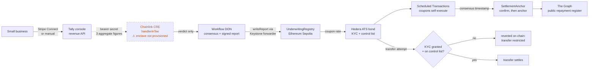

# Tally

A shop's verified revenue becomes a short bond. Underwritten in private, priced in public, settles itself.

Originally built for ETHOnline 2026 (Hedera · Chainlink · The Graph).

**→ [DEMO.md](DEMO.md) is the guided walkthrough** — what to open, what each
thing proves, how to verify it independently, and what doesn't work.

---

## BLI Legal Tech Hackathon 2 submission

**Verified revenue becomes a KYC-gated tokenized bond — underwritten by a
Chainlink CRE workflow that writes its verdict on-chain, serviced by coupons
that execute themselves, and recorded in a public repayment register.**

- **Tracks:** Real World Assets (RWA) · LegalTech & RegTech
- **Bounty:** Chainlink — "Best workflow with CRE"
- **Legal design:** **[docs/LEGAL_AND_REGULATORY.md](docs/LEGAL_AND_REGULATORY.md)** — written for a lawyer reader
- **Architecture:** [docs/ARCHITECTURE.md](docs/ARCHITECTURE.md) · **Submission text:** [docs/BLI_SUBMISSION.md](docs/BLI_SUBMISSION.md) · **Video script:** [docs/BLI_VIDEO_SCRIPT.md](docs/BLI_VIDEO_SCRIPT.md)
- **Live demo:** https://tally-eight-jet.vercel.app/ · **Video:** _PENDING — not yet recorded_
- **License:** [MIT](LICENSE)

> **This is a testnet prototype.** Not an offer of securities, not a regulated
> financial service, no regulatory approval. See the disclaimer at the top of
> the legal doc.

### Architecture



Full diagrams, trust boundaries and the KYC-credential flow:
[docs/ARCHITECTURE.md](docs/ARCHITECTURE.md).

### Chainlink CRE bounty — requirement by requirement

| CRE requirement | Where it lives | Evidence |
|---|---|---|
| 1. A CRE Workflow built, simulated or deployed, used as an **orchestration layer** | [`cre/tally-cre/underwriting/workflow.ts`](cre/tally-cre/underwriting/workflow.ts) — the workflow fetches revenue, applies the underwriting policy, reaches DON consensus, and writes the verdict that sets the bond's coupon rate | Deployed live on Chainlink's DON as `tally-underwriting-staging`, workflow ID `00e48d5e21841e46b17188319ed336cc27e7acf382516c94f8b94cc9a33e23f5` (`cre workflow list --registry private`) — currently **paused**, and its owner key is no longer held, so the reproducible path is the CLI simulation in row 3; 10 workflow tests pass (`bun test`) |
| 2. Integrates **at least one blockchain with an external API / data source** | External API: Tally's own revenue endpoint ([`/api/business/[issuerId]/revenue`](apps/console/app/api/business/%5BissuerId%5D/revenue/route.ts)), called with a Vault-released bearer secret. Blockchain: `EVMClient.writeReport` → [`contracts/src/UnderwritingRegistry.sol`](contracts/src/UnderwritingRegistry.sol) on Ethereum Sepolia | Registry address: [`0xFde2B3180a8D5a72a57d5c4AE0485cBcEF23362c`](https://sepolia.etherscan.io/address/0xFde2B3180a8D5a72a57d5c4AE0485cBcEF23362c) · Chainlink's nodes verified hitting the revenue endpoint (`User-Agent: Go-http-client/1.1`, HTTP 200) |
| 3. A **successful CRE CLI simulation** or **live CRE deployment** | `cre workflow simulate underwriting --target staging-settings --broadcast` | Simulation log: [`docs/evidence/cre-simulation.log`](docs/evidence/cre-simulation.log) · Sepolia verdict tx: [`0xa58ea689…f4e085`](https://sepolia.etherscan.io/tx/0xa58ea689f0b8f3f4cfbcb1f71ca5ccb241a80f0da734d880a1a09fcf94f4e085), verdict read back out of the registry in [`docs/evidence/onchain-verification.txt`](docs/evidence/onchain-verification.txt) (`approved=false, couponBps=760, reasonCode=3` — the policy declining a volatile issuer, not a staged approval) · Live deployment already verified: execution `SUCCESS` with real consensus and a signed report |

**Honest caveat, repeated from below:** the workflow is written for a TEE
(`cre.handlerInTee`), but Chainlink's confidential-workflows capability fails
on this deployment with `cannot validate enclave config: DON members not set`.
The run is real; it is **not** confidential today.

### Proof: the verdict reached the chain

Every figure below was read back out of public infrastructure, not copied from
a log. Raw capture: [`docs/evidence/`](docs/evidence/).

| What | Value |
|---|---|
| Network | Ethereum Sepolia (chain `11155111`, selector `16015286601757825753`) |
| `UnderwritingRegistry` | [`0xFde2B3180a8D5a72a57d5c4AE0485cBcEF23362c`](https://sepolia.etherscan.io/address/0xFde2B3180a8D5a72a57d5c4AE0485cBcEF23362c) |
| Deploy tx | [`0x8bc4e0de…08fe2a`](https://sepolia.etherscan.io/tx/0x8bc4e0de57c08d6ca4a3fbcf61401da7e849d7caf44b7853fd904533ae08fe2a) · block 12,027,293 |
| Verdict tx | [`0xa58ea689…f4e085`](https://sepolia.etherscan.io/tx/0xa58ea689f0b8f3f4cfbcb1f71ca5ccb241a80f0da734d880a1a09fcf94f4e085) · block 12,028,219 |
| Called by | Keystone forwarder [`0x15fC6ae9…1f9F88`](https://sepolia.etherscan.io/address/0x15fC6ae953E024d975e77382eEeC56A9101f9F88) — the only address `onReport` accepts |
| Event | `UnderwritingVerdict` · topic0 `0x326ffcc5…cb935` |
| Stored verdict | `approved=false · couponBps=760 · reasonCode=3 · exists=true` |
| CRE workflow | `tally-underwriting-staging`, ID `00e48d5e…e23f5` (private registry, **paused**) |
| Workflow build | binary `f33a93b8…c1bcf` · config `9b6b358b…7674d` |

```mermaid
sequenceDiagram
    autonumber
    participant API as Tally revenue API<br/>(bearer secret from Vault)
    participant WF as CRE workflow<br/>handlerInTee
    participant DON as Workflow DON
    participant FWD as Keystone forwarder<br/>0x15fC6ae9…
    participant REG as UnderwritingRegistry<br/>0xFde2B318…

    WF->>API: GET /revenue
    API-->>WF: 90d total · volatility · history days
    Note over WF: policy applied in-workflow;<br/>raw figures never leave
    WF->>DON: usingTheDons() — verdict only
    DON->>DON: consensus · sign report
    DON->>FWD: writeReport(receiver, report, gas 3,000,000)
    FWD->>REG: onReport(metadata, report)
    REG->>REG: decode · store · emit UnderwritingVerdict
    REG-->>FWD: ok
    Note over FWD,REG: tx 0xa58ea689… · verdictCount 1 → 2
```

**Verify it yourself**, against public Sepolia — no access to anything of mine
required:

```bash
cast call 0xFde2B3180a8D5a72a57d5c4AE0485cBcEF23362c \
  'latestVerdict(string)((bool,uint256,uint8,uint256,bool))' \
  'issuer-corrados-deli-f5bb20' \
  --rpc-url https://ethereum-sepolia-rpc.publicnode.com

# (false, 760, 3, 1793381952 [1.793e9], true)
#  approved, couponBps, reasonCode, timestamp, exists
```

Reason code `3` is `VOLATILITY_TOO_HIGH`: the issuer's revenue scores 100
against a policy ceiling of 40. **The live verdict is a decline, and that is
the correct answer** — the policy in `packages/underwriting` runs for real
rather than being staged to produce a flattering approval. 760 bps follows the
published formula, 400 + 4 × (100 − 10). The decision is reproducible by anyone
who reads the policy and the stored inputs.

> **A green receipt does not prove a CRE write landed.** The first broadcast
> run returned a transaction hash and a mined receipt with `status: 1`, yet
> `verdictCount` was still `0` — `onReport` had exhausted the gas the forwarder
> passes on, so nothing was stored. The gas limit is now 3,000,000 and the
> workflow treats anything other than an explicit
> `RECEIVER_CONTRACT_EXECUTION_STATUS_SUCCESS` as a failure
> ([regression test](cre/tally-cre/underwriting/workflow.test.ts)). This is why
> the evidence reads contract *state* back rather than citing a receipt.

### Legal & Regulatory Design

- **The bond is treated as a debt security**, not designed around securities
  law. It is issued through Hedera's Asset Tokenization Studio — a permissioned
  ERC-3643-style security token, not a free-floating ERC-20.
- **KYC is enforced by the token, on-chain.** Every transfer checks the
  recipient's KYC status and control-list membership inside the ATS transfer
  function. Tally's `SecondaryMarket` deliberately does *not* pre-check, so a
  rejection proves real enforcement. **Demonstrated live:** an independent
  account with no KYC was refused with `transfer restricted: counterparty not
  compliant`, on the same order a KYC'd account then filled.
- **Verifiable credentials keep PII off the ledger.** KYC is granted by a real
  ECDSA verifiable credential anchored to public DID/revocation registries;
  only a status flag reaches the chain. **The credential is self-signed by
  Tally's custodian key — the mechanism is real, the identity assurance is
  zero.**
- **Data minimisation by construction.** Raw revenue never goes on-chain: only
  `(issuerId, approved, couponBps, reasonCode)` is published. This maps to
  GDPR Art. 5(1)(c) and India's DPDP Act 2023, and protects the business's
  financials as a trade secret.
- **Role separation** — issuer, rate manager, control-list manager, KYC/SSI
  manager, maturity redeemer — are distinct ATS roles, the shape a transfer
  agent and paying agent would occupy.
- **An evidentiary trail that doesn't require trusting Tally:** verdicts signed
  by DON consensus and written on-chain; payment times taken from Hedera
  consensus timestamps, which no party can backdate; confirm-then-anchor
  lifecycle events; a public per-issuer repayment register.
- **Open questions stated, not papered over:** jurisdiction and offering
  exemptions, issuer of record, investor accreditation, default remedies, and
  the status of an algorithmic credit decision under GDPR Art. 22.

### What was added for this hackathon

Everything else in this repository predates it (ETHOnline 2026 — see the git
history). New here:

| Added | Why |
|---|---|
| `contracts/src/UnderwritingRegistry.sol` + 9 Foundry tests | The CRE verdict had no on-chain destination; this closes CRE requirement #2 |
| On-chain write in `cre/tally-cre/underwriting/workflow.ts` (`EVMClient.writeReport`) | The workflow previously stopped at `donRuntime.report(...)` |
| Rewritten `cre/tally-cre/underwriting/workflow.test.ts` | The old tests still targeted a removed template handler |
| `docs/LEGAL_AND_REGULATORY.md` | The legal/compliance analysis law-firm judges are reading for |
| `docs/ARCHITECTURE.md` | Mermaid system, KYC-gate and settlement diagrams with trust boundaries |
| `docs/BLI_SUBMISSION.md`, `docs/BLI_VIDEO_SCRIPT.md` | DoraHacks submission text and a ≤3-minute video script |
| `contracts/deployments/sepolia.json` | Records the deployed registry, its deploy tx and the forwarder it trusts |
| `docs/evidence/` | The simulation log and an independent read-back of the on-chain verdict |
| `LICENSE` (MIT) | The repo had SPDX headers but no license file |

---

## What this is

A shop's revenue is read once, privately, inside a Chainlink Confidential Compute (CRE) enclave. Only a verdict — approve/decline, coupon rate — ever leaves the enclave. That verdict becomes the coupon rate on a Hedera Asset Tokenization Studio bond. Coupons and redemption fire on Hedera Scheduled Transactions, with no keeper bot. Every issuer's repayment history is indexed by a Graph subgraph into a public, queryable performance register.

## Demo data disclosure

**Two businesses in this system — "Corrado's Deli" and "Lifecycle Demo Co" — use synthetic demo revenue data, not a real business's real numbers.** (The second was seeded the same disclosed way, to exercise the post-issuance lifecycle on a short-term bond; see DEMO.md §3.)

Every other business registered through Tally is backed by real data only — either a real connected Stripe account's real settled charges, or real manually-submitted transactions. Tally's underwriting logic never fabricates a number, and the codebase has no mock/fixture path for revenue in the product itself.

These are the only deliberate exceptions, used to demonstrate the full issuance flow (registration → revenue → Chainlink underwriting → Hedera bond issuance → settlement) without waiting on a real business's real multi-month sales history. Their ~95 days of daily revenue were generated by a one-off, out-of-band script (`apps/console/scripts/seed-demo-business.ts`) — not by the product itself, and not reachable through any UI action or API route a real user could trigger. Each is flagged `is_demo` in the database, and every place their revenue is shown in the console displays a visible **"Synthetic demo data — not a real business"** notice.

Everything downstream of that revenue number — the Chainlink CRE workflow's underwriting logic, the Hedera bond issuance, the subgraph indexing, the no-keeper coupon/redemption settlement — runs identically and for real, whether the input revenue came from a real Stripe account or one of these disclosed synthetic seeds.

## Real infrastructure, live and verified

- **Bond issuance** — runs through a real headless-browser signer against the
  real Asset Tokenization Studio Factory contract on Hedera testnet.
  Verified live end-to-end: a bond is created (`Bond.create` +
  `FixedRate.setRate`), its required roles (rate-manager, control-list,
  issuer, maturity-redeemer) are granted, a real self-signed verifiable
  credential grants internal KYC, and the bond's units are actually minted
  to the treasury (`Security.issue`). Real signing, real access-control
  gates, real on-chain transactions — not a simulated mechanism.
- **No-keeper coupon payments** — each coupon is armed as a real Hedera
  `ScheduleCreateTransaction` with `setWaitForExpiry(true)`. Verified live
  on a real 3-coupon bond (`0.0.10519251`): all three executed themselves at
  exactly their due timestamps with zero bot/cron infrastructure, paying
  real HBAR to a real, separately-funded bondholder account. On-time/late
  status is derived from the mirror node's real consensus timestamps, never
  hand-set. Because Hedera refuses a schedule expiring more than ~60 days
  out, coupons are armed progressively as each due date comes into range.
- **Automatic settlement and anchoring** — a background sweep
  (`apps/console/instrumentation.ts`) arms due coupons, confirms each
  payment actually executed via the mirror node, and only then anchors a
  real `Coupon` lifecycle event. Verified live and unattended: all three
  coupons on `0.0.10519251` were anchored to the real `SettlementAnchor`
  (`0.0.10501789`) as successful `CONTRACTCALL`s and recorded on-time —
  the full chain of issue → mint → arm → self-execute → confirm → anchor,
  with no human in the loop.
- **Redemption — known issue, not working.** The call path is implemented and
  reaches the real contract, but `Bond.fullRedeemAtMaturity` reverts with
  empty revert data on a genuinely matured bond, even with every
  precondition on the contract's own modifier list confirmed satisfied
  on-chain (maturity reached, redeemer role, KYC granted, whitelisted, units
  held). It is not out of gas, and the identical calldata simulates fine via
  `eth_call`. One real bug was found and fixed along the way — the SDK
  resolves a `0.0.x` id to the account's long-zero EVM form, which is
  neither whitelisted nor the token holder — but a second empty revert
  remains. Everything ruled out is written up in
  `packages/ats-client/src/redeem.ts`.
- **On-chain infra** — `SettlementAnchor` + `SecondaryMarket` (Foundry, 8
  passing tests) deployed to both Hedera testnet (`0.0.10501789` /
  `0.0.10501801`, the real product deployment) and Ethereum Sepolia — the
  Sepolia copy exists solely because Subgraph Studio doesn't support Hedera
  as an indexable network (see `FEEDBACK/THEGRAPH.md`).
- **Subgraph** — deployed live: https://thegraph.com/studio/subgraph/tally-register,
  indexing lifecycle events from the Sepolia deployment above.
- **Chainlink CRE workflow** (`cre/tally-cre`) — deployed on Chainlink's real
  DON as `tally-underwriting-staging` (workflow ID `00e48d5e…e23f5`), now
  **paused**, and its owner key is no longer held. It
  fetches a business's real revenue from the console's API, applies the real
  underwriting policy, and reports only the verdict. Verified from both
  sides: Chainlink's nodes hit the revenue endpoint (`User-Agent:
  Go-http-client/1.1`) and got real revenue data back, and the execution
  reported SUCCESS with real consensus and a signed report.
  **Caveat, stated plainly:** the TEE enclave itself is not running. Even on
  a SUCCESS execution the `confidential-workflows` capability fails with
  `cannot validate enclave config: DON members not set` — Chainlink-side
  provisioning for the private registry's DON family. So the run is real,
  but it is *not* confidential, and shouldn't be described as such until
  that clears. See `cre/tally-cre/README.md` and `FEEDBACK/CHAINLINK.md`.
- **Console UI** — Next.js app for business registration, Stripe Connect,
  and the underwriting/bond-issuance flow, styled and wired to all of the
  above.

## Running it

```bash
pnpm install                 # also builds the ATS browser-signer bundle
cd apps/console && pnpm dev  # http://localhost:3000
```

A real `.env` at the repo root is required (see `.env.example`); the console
loads it automatically. `apps/console/.env.local` must also carry
`DATABASE_URL` — a Postgres connection string (Tally uses Neon, connected
through Vercel's Storage tab).

Production builds need a larger Node heap than the default:
`NODE_OPTIONS=--max-old-space-size=6144 pnpm build`.

### Where things run

State lives in one shared **Postgres** database, so the local console and
the hosted Vercel deployment always show the same businesses, bonds and
coupons.

**Runs on Vercel:** every page, business registration, Stripe Connect and
revenue sync, the `/revenue` endpoint Chainlink's DON reads, the market book
and the public register.

**Runs only from the local console**, by design:

- **Bond issuance, escrow and order fills drive a real headless Chromium.**
  Hedera's Asset Tokenization Studio SDK gates its write path behind real
  browser globals (`Injectable.isWeb()`, `window.ethereum`), so
  `packages/ats-client` signs through an actual Playwright-driven browser
  with a real wallet shim — and holds the custodian key. Neither belongs in
  a serverless function. The hosted deployment refuses these routes with an
  explicit `501`; their results still land in the shared database and show
  up on the hosted site immediately.
- **Settlement is a long-lived background sweep.** `instrumentation.ts`
  arms coupons, confirms payments on the mirror node and anchors events on a
  timer, which needs a long-lived process.
- **Value-moving routes are local-only even locally.** A request that
  arrives through a proxy is refused unless it presents `TALLY_ADMIN_TOKEN`
  — see `apps/console/lib/api-guard.ts`.

To move existing data from an older SQLite `tally.db` into Postgres:
`cd apps/console && npx tsx --env-file=.env.local scripts/migrate-sqlite-to-postgres.ts tally.db`
(idempotent — safe to re-run).

## Repository layout

- `apps/console` — the Next.js product surface (business registration, revenue, Stripe Connect, bond issuance UI)
- `packages/seam` — shared types and fixed-point money helpers
- `packages/underwriting` — revenue-snapshot computation and coupon pricing policy
- `packages/ats-client` — Hedera Asset Tokenization Studio SDK client, including a real headless-browser signer (`browser-runner/`) since the SDK requires a real browser context to sign transactions
- `packages/scheduler` — Hedera Scheduled Transactions for no-keeper coupon/redemption settlement
- `contracts` — `SettlementAnchor` and `SecondaryMarket` (Foundry)
- `subgraph` — The Graph subgraph indexing lifecycle events
- `cre/tally-cre` — the Chainlink CRE confidential underwriting workflow
- `FEEDBACK/` — real, specific feedback for each sponsor (Hedera, Chainlink, The Graph), grounded in issues actually hit building this
