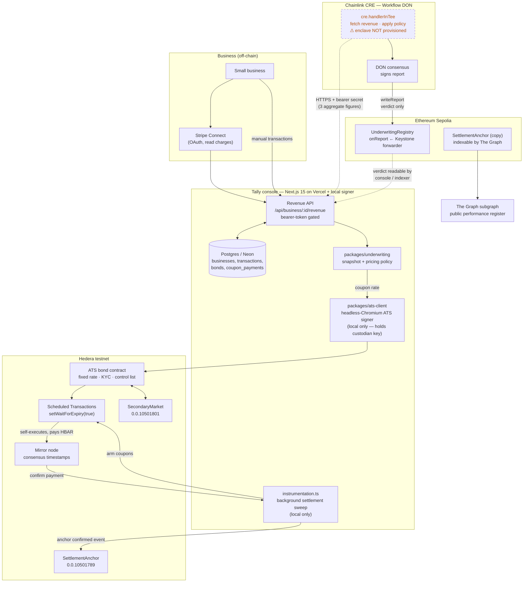
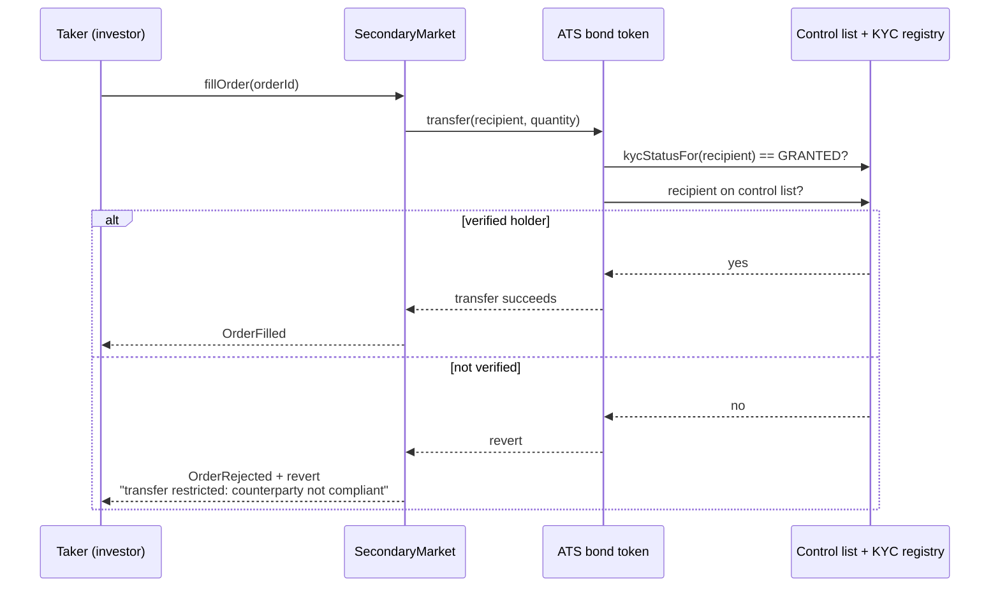
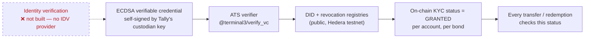
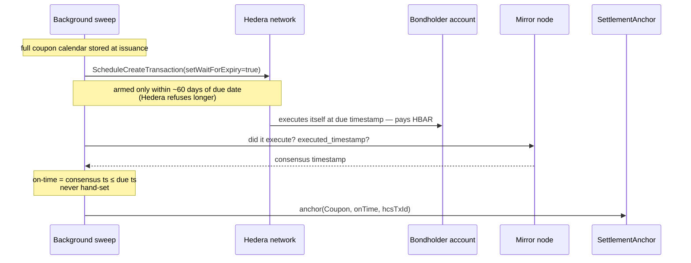

# Tally — Architecture

How a business's revenue becomes a transfer-restricted bond that services
itself, and where the trust boundaries sit.

> Diagrams show what runs **today**. The Chainlink TEE enclave is drawn as a
> dashed, disabled boundary because the confidential-workflows capability is
> not provisioned on this deployment (see
> [LEGAL_AND_REGULATORY.md §4](LEGAL_AND_REGULATORY.md#4-data-privacy-and-confidentiality)
> and `cre/tally-cre/README.md`).

## 1. End-to-end system



### Trust boundaries and private data

| Boundary | Crosses it | Confidentiality today |
|---|---|---|
| Business → Tally | Full Stripe charge history | Tally sees everything. It is the data controller. |
| Tally → Chainlink DON | 3 aggregate figures only (90-day total, volatility, history days) | Sent over HTTPS with a Vault-released bearer secret. **Visible to node operators** while the enclave is unprovisioned. |
| DON → Sepolia | `(issuerId, approved, couponBps, reasonCode)` | Public and intended to be. Revenue is not reconstructable from it. |
| Tally → Hedera | Bond terms, holder addresses, KYC status flags | Public. No identity documents on-chain. |
| Hedera → The Graph | Lifecycle events | Public by design (the performance register). |

The custodian private key stays on the local machine. It is never present in
a Vercel function, which is why issuance, escrow and order fills return `501`
on the hosted deployment.

## 2. Underwriting and the on-chain verdict

```mermaid
sequenceDiagram
    participant CRON as CRE cron trigger
    participant TEE as handlerInTee (enclave ⚠ not provisioned)
    participant VAULT as Vault DON
    participant API as Tally revenue API
    participant DON as Workflow DON
    participant FWD as Keystone forwarder
    participant REG as UnderwritingRegistry (Sepolia)

    CRON->>TEE: fire on schedule
    TEE->>VAULT: getSecret(REVENUE_API_TOKEN)
    VAULT-->>TEE: secret, released into attested enclave
    TEE->>API: GET /revenue  (Authorization: Bearer …)
    API-->>TEE: {trailing90dTotalUSD, volatilityScore, historyDays}
    Note over TEE: classifyDecline() + computeDiscountRate()<br/>raw figures never logged
    TEE->>DON: usingTheDons() — verdict only
    DON->>DON: consensus, sign report
    DON->>FWD: writeReport(receiver = registry)
    FWD->>REG: onReport(metadata, report)
    Note over REG: only the forwarder may call;<br/>ERC165 advertises IReceiver
    REG-->>REG: store verdict + emit UnderwritingVerdict
```

`usingTheDons()` is a one-way door: chain writes always execute on Workflow
DON nodes, so the write necessarily happens after the crossing. That is safe
here precisely because only the verdict crosses.

## 3. Investor transfer and the KYC gate

The compliance check lives in the ATS token, not in Tally's UI. `SecondaryMarket`
deliberately does not pre-validate the buyer, so a rejection proves the token's
own enforcement.



How KYC is granted (`packages/ats-client/src/kyc.ts`):



**The mechanism is real; the assurance is not.** No person or entity is
identity-verified. Only the address → credential → status plumbing works, which
is the part a real KYC provider would slot into.

## 4. Settlement: coupons that execute themselves



No keeper bot executes the payment. The sweep only *arms* schedules in advance
and *confirms* afterwards. Hedera itself does the paying, which is why the
payment time cannot be backdated by Tally or the issuer.

## 5. Where each component runs

| Component | Runs on | Why |
|---|---|---|
| Pages, registration, Stripe sync, revenue API, market book, register | Vercel (`sin1`, next to the database) | Stateless HTTP |
| Bond issuance, escrow, order fills | **Local only** | The ATS SDK signs only inside a real browser (`Injectable.isWeb()`, `window.ethereum`), so a Playwright-driven Chromium with an EIP-1193 shim holds the custodian key. Neither belongs in a serverless function. Hosted routes return `501`. |
| Settlement sweep | **Local only** | Needs a long-lived process. |
| State | Postgres (Neon) | Shared, so local and hosted show identical data. |
| CRE workflow | Chainlink's private registry, `tally-underwriting-staging` | Off-chain registry; the on-chain one charges mainnet gas. |
| Subgraph | Subgraph Studio, indexing **Sepolia** | Studio cannot index Hedera (`FEEDBACK/THEGRAPH.md`). |

## 6. Repository map

```
apps/console          Next.js product surface + revenue API + settlement sweep
packages/seam         shared types, 6-decimal fixed-point money (never floats)
packages/underwriting revenue snapshot + coupon pricing policy
packages/ats-client   Hedera ATS client, headless-browser signer, KYC, roles, redeem
packages/scheduler    Hedera Scheduled Transactions, mirror-node confirmation
contracts             SettlementAnchor, SecondaryMarket, UnderwritingRegistry (Foundry)
cre/tally-cre         Chainlink CRE underwriting workflow (+ on-chain verdict write)
subgraph              The Graph mappings → per-issuer performance register
```
